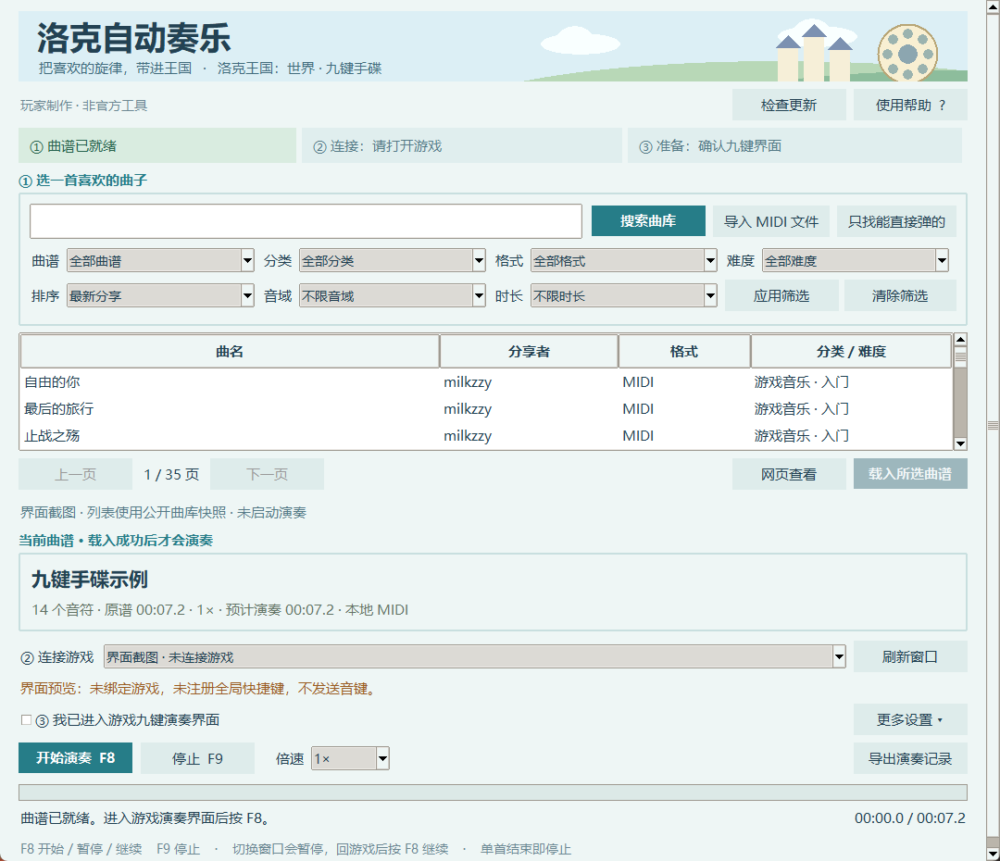
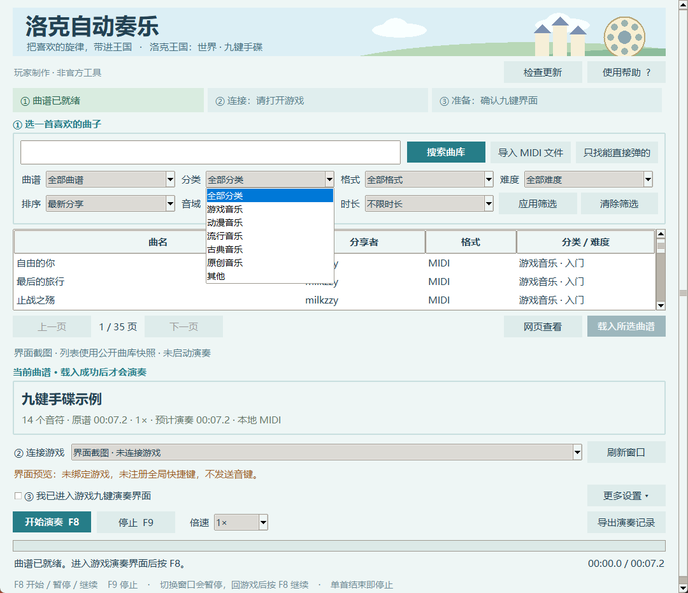
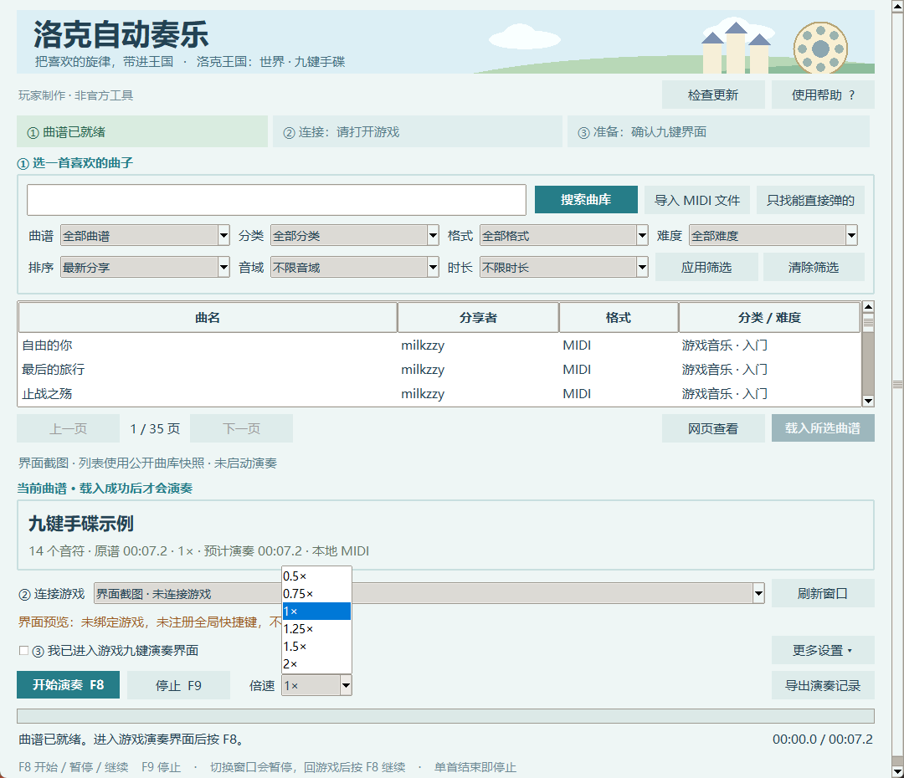
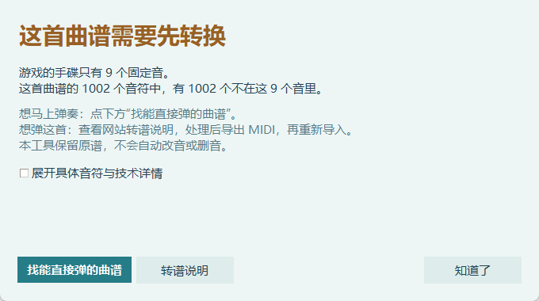
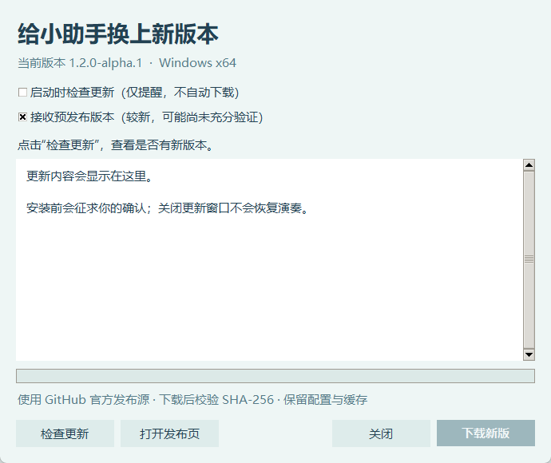

# 洛克自动奏乐 · Roco Auto Music

面向 Windows 的《洛克王国：世界》九键手碟自动奏乐工具。Python / Tkinter 小窗口，支持 [RocoMusic](https://rocomusic.cn/) 曲库搜索、网页同款筛选、本地 MIDI 和倍速。

**当前为开发预发布版本。更新、界面、筛选与倍速未完成运行验收；安装包仅完成构建，尚未安装/卸载实测。** 此前开发版本曾人工验证九键、重复音、双音及《蜜雪冰城》可奏响，不代表当前版本或其他电脑已经通过验收。详见 [验证状态](docs/STATUS.md)。

## 下载安装

无需自行安装 Python，选择一种方式：

- **[Windows x64 安装包](https://github.com/LuoJinBin/roco-auto-music/releases/download/v1.2.0-alpha.1/RocoAutoMusic-Setup-1.2.0-alpha.1-x64.exe)**：安装到用户目录，提供开始菜单入口、可选桌面快捷方式与卸载。
- **[免安装 ZIP](https://github.com/LuoJinBin/roco-auto-music/releases/download/v1.2.0-alpha.1/RocoAutoMusic-1.2.0-alpha.1-Windows-x64.zip)**：解压后运行 `RocoAutoMusic.exe`。
- [完整 Release、源码与 SHA-256 校验值](https://github.com/LuoJinBin/roco-auto-music/releases/tag/v1.2.0-alpha.1)。

安装包不会自动启动程序、安装系统驱动或重启电脑。首次使用 Interception 输入仍需自行配置官方系统驱动；已经配置过的电脑无需重复安装。驱动获取与安装步骤见 [首次使用说明](docs/INSTALL.md)。

## 界面截图

天空、草地、城堡与手碟均为工具原创绘制，没有使用游戏官方素材。实际工具界面截图；曲库列表为公开页面快照。截图期间未绑定游戏、未启用全局快捷键或发送音键，不代表演奏测试通过。



<details><summary>查看分类筛选</summary>



</details>

<details><summary>查看六档倍速</summary>



</details>

<details><summary>查看友好的曲谱处理提示</summary>



</details>

<details><summary>查看更新窗口</summary>



</details>

## 功能

- 默认显示全部曲谱，支持曲谱/精选、分类、格式、难度、排序、音域和时长 7 项筛选。
- 应用/清除筛选、关键词搜索、分页；翻页保留上次已应用条件。
- 标准 MIDI Type 0/1、本地 `.mid/.midi`，完整下载后离线演奏；保留多轨、变速、休止和同时起音。
- 倍速：0.5×、0.75×、1×、1.25×、1.5×、2×，默认 1×。
- F8 开始/暂停/继续，F9 停止复位；首次开始倒计时 3 秒。
- 每首播放完停止，不循环、不自动下一首；切换到其他窗口自动暂停。
- 超范围曲谱给出处理入口：找九键可直奏曲谱、查看转谱说明、展开音符详情；不自动改音或删音。
- 三步就绪提示、悬停说明、中文帮助；新曲载入失败后清空旧曲，避免误奏。
- 基于 GitHub Releases 检查更新、稳定/预发布通道、可选启动提醒、下载/取消、SHA-256 校验和确认后退出安装。无需自建后端。

全部格式均可浏览，自动演奏仅支持 MIDI。图片/PDF/JSON/TXT 可打开网页查看，不直接识别为演奏事件。在线曲谱和作者信息属于各自分享者，本仓库不附带社区曲谱。

## 更新

右上角“检查更新”可查看新版本和说明，下载完成校验通过后，再确认“退出并安装”。保留本地配置与缓存，不自动奏乐、安装驱动或重启。启动检查默认关闭；本开发版默认接收预发布，可自行关闭。便携用户也可从发布页下载新版 ZIP。

**1.1 旧版需要先手动下载安装一次 1.2，之后才有更新入口。** 当前只完成代码与打包，更新安装全链路未实测。详见 [更新说明与发布规范](docs/UPDATES.md)。

## 环境与输入方式

- Windows x64；开发环境使用 Python 3.14，需包含 Tkinter。
- 默认在检测到驱动后选择 Interception；也保留普通扫描码/虚拟键输入。
- Interception 模式需要使用者自行配置官方驱动。程序和依赖获取脚本都不会自动安装驱动、重启、关闭安全功能或读写游戏内存。
- 游戏以管理员权限运行时，源码运行窗口也需要相应权限；打包 EXE 会请求 Windows 管理员确认。

### 从源码运行

```powershell
git clone https://github.com/LuoJinBin/roco-auto-music.git
cd roco-auto-music
python -m venv .venv
.\.venv\Scripts\python.exe -m pip install -r requirements.txt
.\.venv\Scripts\python.exe tools/fetch_interception.py
.\.venv\Scripts\python.exe main.py
```

`fetch_interception.py` 从官方 v1.0.1 发布资产获取并校验 DLL，保存下载 ZIP 到被 Git 忽略的 `.vendor/`，**不安装任何驱动或执行下载文件**。需要驱动时，从该官方 ZIP 中找到 `command line installer/install-interception.exe`，自行决定是否以管理员身份安装，保存工作后再自行重启。驱动安装是系统变更，不是启动程序的自动步骤；已经配置过的电脑无需重复安装。

### 打包 EXE

```powershell
.\.venv\Scripts\python.exe -m pip install -r requirements-build.txt
.\.venv\Scripts\python.exe build.py
```

输出为 `dist/RocoAutoMusic.exe`。打包过程不启动程序或执行测试。Git 源码不存放 DLL、驱动或 EXE；Release 程序包包含动态链接的 Interception 库、许可及库源码副本，不包含系统驱动安装器。项目自有代码采用 MIT，第三方组件仍按其上游条款使用，见 [第三方说明](THIRD_PARTY_NOTICES.md)。

安装包构建脚本为 `installer/RocoAutoMusic.iss`，使用 Inno Setup。向 ISCC 传入 `PayloadDir`、`OutputDir` 和可选 `AppVersion` 预处理参数；`PayloadDir` 指向包含程序、许可、依赖源码和中文说明的发布目录。编译安装包不执行安装。

也可使用 `tools/build_release.py --iscc <ISCC路径> --interception-source <上游源码ZIP路径>` 准备完整目录、复制许可和对应源码，并编译安装包与免安装 ZIP。固定版本的上游源码 ZIP 随 Release 提供。截图脚本为 `tools/capture_screenshots.py`，其可选依赖见 `requirements-screenshots.txt`；它只启动隔离预览，不绑定游戏或启用全局快捷键。

## 使用

1. 启动工具，默认读取全曲库第一页；输入曲名或选择筛选后点“应用筛选”。也可导入本地 MIDI。
2. 选择游戏窗口，进入游戏九键演奏界面，勾选“我已进入游戏九键演奏界面”。
3. 按需选择倍速，默认为 1×。按 F8 或点击开始，3 秒内切回游戏。
4. F8 暂停/继续，F9 停止回到开头。切换窗口会自动暂停，切回来后需主动继续。
5. **单首播放完即停止。** 只有再次主动开始才会重播；不会自动接着放另一首。

在工具中修改倍速时，切窗暂停规则仍然生效。进度显示原谱位置，曲谱说明列出预计演奏时长。短按默认 30 ms，不随倍速直接缩短；密集同键会留出释放间隔，所选倍速下小于 4 ms 的同键间隔会被拒绝。

### 九键映射

| MIDI 音高 | 45 | 52 | 53 | 55 | 57 | 59 | 60 | 62 | 64 |
|---|---|---|---|---|---|---|---|---|---|
| 游戏键 | B | F | G | H | J | K | T | Y | U |

只在绑定游戏窗口处于前台时发送音键。工具不识别游戏内当前场景，退出演奏界面前请先停止。原谱绝对时间调度用于避免累计误差；落后超过 100 ms 时暂停，避免突发补音。发送日志不能证明游戏已接受输入或实际发声。

## 数据与网络

缓存和日志在 `%LOCALAPPDATA%\RocoAutoMusic`。网站收到搜索词和筛选参数；下载完成后的 MIDI 解析、调度在本机进行。更新查询由 GitHub 接收普通公开 API 请求，不上传曲谱或账号，不需要 Token。程序不录音、不截图，不读取账号、Cookie 或游戏内存。

在线读取使用 Windows 证书验证，不忽略 TLS 错误；网站返回 HTTP 401/403/412/429、安全验证或明确拒绝时停止读取，不切换身份或后端。非 MIDI 和不兼容音符不会静默转换。

## 参与开发

欢迎提交 Issue 或 Pull Request，说明复现步骤、Windows/Python 版本、输入模式与预期行为。不要上传账号信息、设备标识、下载缓存或他人曲谱。测试代码保存在 `tests/`；本次公开发布未运行这些测试，也没有配置自动测试工作流。

## 许可

本项目自有源码采用 [MIT](LICENSE)。第三方组件不因本项目的 MIT 许可而改变许可；Interception 上游明确区分非商业与商业使用，参见 [第三方说明](THIRD_PARTY_NOTICES.md)。

本项目与游戏官方和 RocoMusic 网站无隶属关系。
